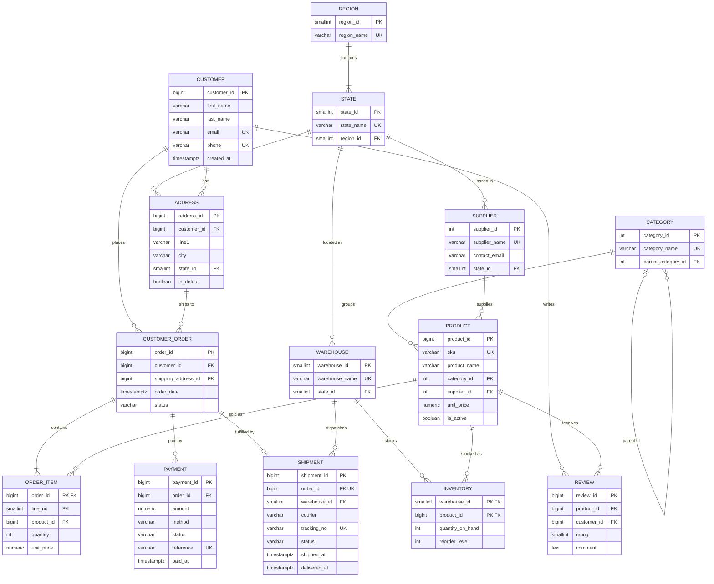

# EkoMart Online - ER Diagram

Crow's-foot notation. GitHub renders this diagram automatically. To export it as an image, paste the code block into <https://mermaid.live> and download a PNG into `evidence/`.

